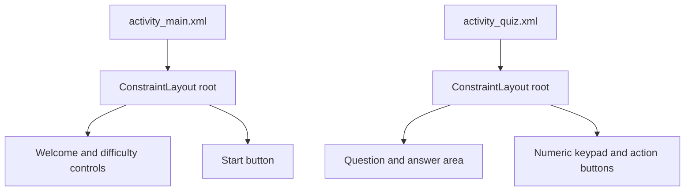

# Android Math Quiz Layouts

**Two Android XML screen layouts from the Penn CIS 350 Homework 4 starter project, Spring 2020.**

This repository is a fork of [cis350/20sp-hw4](https://github.com/cis350/20sp-hw4). It preserves the assignment's starter layout files. It does not contain a complete quiz application or demonstrate a finished implementation of the assignment.

## Included screens

| Layout | Contents |
| --- | --- |
| [activity_main.xml](code/activity_main.xml) | Welcome screen, difficulty selector, Start button and student-name placeholder |
| [activity_quiz.xml](code/activity_quiz.xml) | Arithmetic-question display, answer area, numeric keypad, Clear button and Submit button |

Both layouts use AndroidX `ConstraintLayout` as the root container and nested `LinearLayout` elements for arranging controls. The quiz numbers and labels are static examples in the XML.

## View structure

This diagram shows the two independent layout trees. It intentionally does not connect the Start button to the quiz screen because navigation and event handlers are not implemented in this checkout. The useful material here is the arrangement of Android views, constraints, and nested containers; application state and arithmetic behavior would belong in additional source files.

## Explore the layouts

Open the XML files to inspect the view hierarchy and layout attributes. To preview them in Android Studio, place copies in an Android project's `app/src/main/res/layout` directory and provide the AndroidX ConstraintLayout dependency.

This checkout does not include Gradle configuration, a manifest, activity classes, question-generation logic or button event handlers. It cannot be built or installed as an app on its own.

## Attribution and portfolio context

The original teaching material belongs to the CIS 350 starter repository and retains its upstream attribution. This fork is kept as coursework history. For substantial public implementations, see [PennOS](https://github.com/Jaiashar/penn-os), [PennShell](https://github.com/Jaiashar/penn-shell), and my [main portfolio](https://github.com/Jaiashar).
